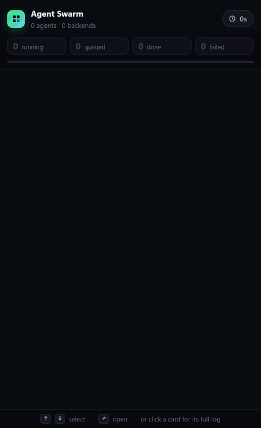
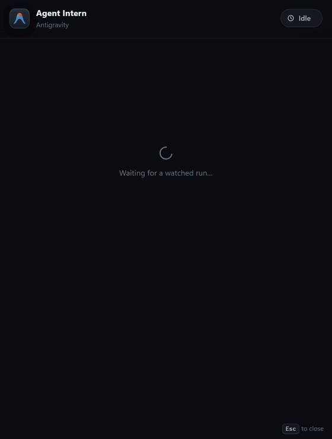
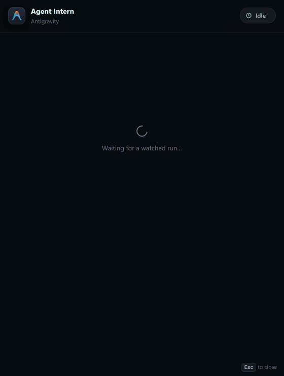
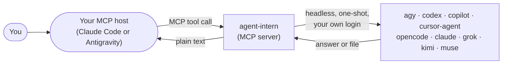

<div align="center">

# agent-intern

### Give Claude Code (or Antigravity) an intern.

Delegate to **Gemini, Codex, Copilot, Cursor and opencode** from inside Claude Code or Antigravity — as sub-agents,
on the subscriptions you already pay for. Text answers, image generation, real repo work, parallel swarms.

[](https://github.com/SinanTufekci/agent-intern/actions/workflows/ci.yml)
[](https://pypi.org/project/agent-intern/)
[](https://pepy.tech/projects/agent-intern)
[](https://github.com/SinanTufekci/agent-intern/blob/main/LICENSE)
[](https://glama.ai/mcp/servers/SinanTufekci/agent-intern)



[Quick start](#quick-start) · [Works in](#works-in) · [What it's for](#what-its-for) · [Backends](#backends) · [Security](#security) · [Docs](https://github.com/SinanTufekci/agent-intern/blob/main/docs/README.md)

</div>

<!-- mcp-name: io.github.SinanTufekci/agent-intern -->

Claude Code is one model on one quota. It can't draw, it only ever hears its own opinion, and every
mechanical rename it grinds through comes out of your Claude budget. Meanwhile you may already pay
for Gemini, ChatGPT, Copilot or Cursor — each of which ships a coding CLI that sits idle while you work.

**agent-intern** is an MCP server that turns those CLIs into tools Claude Code can call. Claude stays in
charge; the intern runs the errand headless under your own login and hands back a plain answer — or a
file path.

It also runs the other way. In a host that isn't Claude Code (Antigravity, Copilot, Cursor or
opencode), the same server adds a Claude Code backend: `claude_status` answers in all four, and
`claude_ask` hands work to Claude on your own Claude login (verified from the Antigravity CLI).
[Works in](#works-in) has the rest.

## Quick start

**1. Install it** (needs [uv](https://docs.astral.sh/uv/)). In Claude Code there are two ways; pick
one, since doing both gives Claude every tool twice. (Using another host? See [Works in](#works-in).)

- **The plugin — recommended.** It registers the server and adds three slash commands:

  ```bash
  claude plugin marketplace add SinanTufekci/agent-intern
  claude plugin install agent-intern@agent-intern
  ```

- **Just the MCP server:** `claude mcp add -s user agent-intern -- uvx agent-intern`

**2. Install at least one backend CLI and sign in once.** Any one of them works on its own:

| If you have… | Install | Sign in |
|---|---|---|
| Google AI Pro | [`agy`](https://antigravity.google/) | once, via the IDE or `agy -i` |
| a ChatGPT plan or OpenAI key | [`codex`](https://developers.openai.com/codex/) | `codex login` |
| GitHub Copilot | `npm i -g @github/copilot` | `copilot`, then `/login` |
| Cursor | [`cursor-agent`](https://cursor.com/cli) | `cursor-agent login` |
| **nothing at all** | `npm i -g @opencode/cli` | not needed — its free models answer with zero credentials |

**3. Restart Claude Code and just ask.** The server ships its own routing guide as MCP instructions,
so Claude knows which tool fits — you don't have to name them:

- *"Ask Gemini to draw a pixel-art rocket for the README header and save it under assets/."* → Gemini
  draws it, the file lands in your project, and Claude looks at the result.
- *"Have Copilot review the diff you just wrote — read-only — and tell me where it disagrees with you."*
  → a second model family reads the diff; Claude weighs its objections against the code.
- *"Summarise each of the six files in src/handlers in parallel with a swarm."* → one `agent_swarm`
  call, six workers at once, one answer block back.

With the plugin you also get three slash commands:

| Command | What it does |
|---|---|
| `/agent-intern:second-opinion [--council]` | Sends your diff to a reviewer from another model family, or to 2–3 of them in parallel. Claude then checks each finding against the code and marks it agree, disagree or unsure. |
| `/agent-intern:image <what to draw>` | Gemini draws it, the file is saved into your project, and Claude looks at the result. |
| `/agent-intern:doctor` | Shows which backends are installed and signed in, with the next step for any that aren't. Spends no quota. |

Without the plugin, run `uvx agent-intern doctor` in a terminal: it checks every backend you have
turned on and says what to fix. It spends no quota, and needs no host. Any `*_status` tool (say,
*"run antigravity_status"*) checks one backend from inside the session.

> [!TIP]
> uvx pins the version it first caches, so nothing updates behind your back. Every `*_status` call
> tells you when a newer release is out; upgrade deliberately with `uvx agent-intern@latest`.
> [Other install paths, from source included →](https://github.com/SinanTufekci/agent-intern/blob/main/docs/setup.md)

<div align="center">

<br>
<sub><code>agent_swarm(..., watch=true)</code> — one card per worker, each on a different backend.
<a href="https://github.com/SinanTufekci/agent-intern/blob/main/docs/watch-and-swarm.md">More on watch mode and swarms →</a></sub>
</div>

## Works in

The server is plain stdio MCP, so the same `uvx agent-intern` runs in each host below. Only the place
you register it differs.

**Claude Code.** The plugin or `claude mcp add`, as in [Quick start](#quick-start). The plugin also
adds the `/agent-intern:*` slash commands, and the whole routing guide (about 3.4 KB, under Claude
Code's 4,096-character cap) reaches Claude, so you don't have to name a tool.

<details>
<summary><b>Antigravity CLI</b> · <code>agy mcp add agent-intern uvx agent-intern</code></summary>

One command registers it; it writes `~/.gemini/config/mcp_config.json` for you, so there is
nothing to hand-edit:

```bash
agy mcp add agent-intern uvx agent-intern
```

All 32 tools load under their bare names (`antigravity_ask`, `claude_ask`, …), three more than in
Claude Code, which hides the Claude Code tools. Every `agy` run
picks the registration up with no restart (verified on agy 1.5.1). To load only some backends, pass
the variable along: `agy mcp add --env AGENT_INTERN_BACKENDS=opencode,antigravity agent-intern uvx agent-intern`.
Remove it with `agy mcp remove agent-intern`. Three things differ from Claude Code:

- **Headless `agy -p` auto-denies MCP tool calls.** Add a rule such as
  `mcp(agent-intern/opencode_status)` to `permissions.allow` in
  `~/.gemini/antigravity-cli/settings.json`, or run `agy` interactively and approve each call.
  `{"permissions":{"allow":["mcp(*)"]}}` in that file let headless calls through too (verified on
  agy 1.5.3). `mcp(*)` is a wildcard: treat it as allowing every MCP tool of every server you
  register, and prefer per-tool rules where you can.
- **agy shows the model no server instructions**, and lists an MCP tool by name only. agy reads
  `AGENTS.md` and `GEMINI.md`: write the guide into one with `uvx agent-intern rules > AGENTS.md`,
  or name the tool in your prompt: *"use opencode_ask to review this diff"*.
- **No slash commands.** Run `uvx agent-intern doctor` instead.

`antigravity_ask` called from inside `agy` works, with no lock or conversation clash, and so does
`claude_ask` (verified on claude 2.1.319). `watch=true`
under `agy` hasn't been tested. The Antigravity IDE keeps its own MCP server list, which
`agy mcp add` doesn't touch; adding agent-intern there is untested too.

</details>

> [!CAUTION]
> Antigravity: don't paste the output of `agy mcp list` into an issue or a chat: it prints each
> registered server's full command line, including any API keys passed in it.

<details>
<summary><b>GitHub Copilot CLI</b> · <code>copilot mcp add agent-intern -- uvx agent-intern</code></summary>

The same command shape registers it; `copilot mcp add` writes `~/.copilot/mcp-config.json` for you:

```bash
copilot mcp add agent-intern -- uvx agent-intern
```

All 32 tools load, and `opencode_status` and `claude_status` were called (verified on copilot
1.0.105 / Windows against the 0.36 server, with the same command shape; the test launched the server
through Python rather than `uvx`). To try it without writing a file, pass the
server definition as JSON with `--additional-mcp-config`. Differences from Claude Code:

- **Tool names are `<server>-<tool>`**, e.g. `agent-intern-opencode_status`.
- **The routing guide reaches the model only with `--allow-all-mcp-server-instructions`.** Pass it,
  write it into a file Copilot reads (`uvx agent-intern rules > AGENTS.md`; Copilot reads
  `.github/copilot-instructions.md`, `AGENTS.md`, `CLAUDE.md` and `GEMINI.md`), or name the tool in
  your prompt.
- Headless `copilot -p … -s` calls the tools with no extra allow flag.

</details>

<details>
<summary><b>Cursor CLI</b> · add <code>agent-intern</code> to <code>.cursor/mcp.json</code></summary>

Add the server to `.cursor/mcp.json` in your project (or `~/.cursor/mcp.json` for every project):

```json
{
  "mcpServers": {
    "agent-intern": {
      "command": "uvx",
      "args": ["agent-intern"]
    }
  }
}
```

All 32 tools load, the routing guide reaches the model, and `opencode_status` and `claude_status`
both passed (verified on cursor-agent 2026.11.05 / Windows against the 0.36 server). Only the project file was tested; `~/.cursor/mcp.json` follows Cursor's documented format
but wasn't run. Differences from Claude Code:

- **Headless runs reject MCP calls unless you pass both `--approve-mcps` and `--force`.** After
  that, the approval persists per workspace. Interactive runs simply ask. Note that `--force` also
  lets `cursor-agent` itself write files without asking.
- The Cursor IDE wasn't tested.

</details>

<details>
<summary><b>opencode</b> · <code>opencode mcp add agent-intern -- uvx agent-intern</code></summary>

The same command shape registers it. Without `--global` it writes `opencode.json` in the current
directory (your project):

```bash
opencode mcp add agent-intern -- uvx agent-intern
```

Or write the entry by hand:

```json
{
  "mcp": {
    "servers": {
      "agent-intern": {
        "type": "local",
        "command": ["uvx", "agent-intern"]
      }
    }
  }
}
```

All 32 tools load, and `opencode_status` and `claude_status` were called through Code Mode (verified
on opencode 2.2.5 / Windows against the 0.36 server, with a free model and the same command shape;
the test launched the server through Python rather than `uvx`). `--global` writes
`~/.config/opencode/opencode.jsonc` instead; that wasn't run. Differences from Claude Code:

- **opencode 2.x doesn't expose MCP tools as separate tools.** The model reaches them through
  opencode's Code Mode `execute` tool, as `tools["agent-intern"].opencode_status()`. An opencode
  policy that denies `execute` makes them unreachable (per opencode's docs).
- **Whether the routing guide reaches the model is unconfirmed:** opencode's source forwards it, but
  three runs on a free model said the model had none. opencode reads `AGENTS.md`: write the guide
  there with `uvx agent-intern rules > AGENTS.md`, or name the tool in your prompt.
- Headless `opencode run` called the tool with no extra approval.
- **Don't use `opencode mcp list` as a load check:** it printed "No MCP servers configured" while
  the server was loaded.

</details>

`uvx agent-intern doctor` does what `/agent-intern:doctor` does, in any host or in a plain terminal
(`--verbose` for every check, `--json` for scripts). `uvx agent-intern rules` prints the routing guide for hosts that
don't show MCP instructions to their model: `uvx agent-intern rules > AGENTS.md` writes it where agy,
Copilot CLI, Cursor CLI and opencode all read it (or append it to an existing `AGENTS.md`; home-level
rules files weren't tested). Any other host that speaks stdio MCP *should* work with the same
`command` and `args`, but none has been tested yet.

## What it's for

| The job | By hand | With agent-intern |
|---|---|---|
| 🎨 **Draw an image** | Leave the session, open an image tool, copy the file back | `antigravity_image` has Gemini draw it and returns the saved file: no extra API key, no extra tool |
| 🧠 **A second opinion** | Paste the diff into another chat and relay what it says | A different model family reviews it in place. Their blind spots rarely overlap with Claude's |
| 🐝 **Many tasks at once** | One terminal per CLI, one prompt each, collect the answers yourself | `agent_swarm` runs N tasks in one call and can mix backends (~2.8× at 3 Gemini workers) |
| ⚖️ **A scored verdict** | Run the same material through three CLIs and tally the scores | `preset_swarm` runs a jury against a rubric, a research panel, a red team or a code-review council in one call, or a panel you define |
| 💸 **Grunt work** | Claude grinds through the renames and boilerplate on your Claude budget | Bulk renames, boilerplate and first-pass ports burn *their* quota instead of Claude's tokens |

- 🆓 **No subscription? Still works.** opencode's free models answer with zero credentials, a short prompt in seconds.
- 🔌 **Zero new auth.** Piggybacks the CLI logins you already have. The bridge manages no keys of its own.

### Watch it work

Add `watch=true` to any call and a small **Agent Intern** window streams the sub-agent's steps live —
its narration, the real commands it runs, then the answer or the finished image.

<table>
<tr>
<td width="50%" align="center"><b>a text ask</b></td>
<td width="50%" align="center"><b><code>antigravity_image</code> — image inline</b></td>
</tr>
<tr>
<td></td>
<td></td>
</tr>
</table>

<sub>Swarms get a dashboard too (the animation under Quick start): one card per worker, and a click pops that
agent into its own window.
<a href="https://github.com/SinanTufekci/agent-intern/blob/main/docs/watch-and-swarm.md">More on watch mode and swarms →</a></sub>

### Ready-made panels

`preset_swarm` runs a whole panel in one call. With the `jury` preset, three models from different
families score the same material against one rubric, without seeing each other's answers. The bridge
does the arithmetic and flags where they disagree:

```
preset_swarm(preset="jury", material="<the full pitch>")
```

| Criterion | Technical · codex | Impact · antigravity | Skeptical · copilot | Mean | Spread |
|---|---:|---:|---:|---:|---:|
| Originality | 3 | 3 | 3 | 3 | 0 |
| Feasibility | 2 | 3 | 2 | 2.3 | 1 |
| Impact | 7 | 4 | 6 | 5.7 | 3 ⚠ |
| Clarity | 5 | 5 | 6 | 5.3 | 1 |
| **Weighted total** | **4.0** | **3.5** | **3.9** | **3.8** | 0.5 |

<sub>A real run on a made-up pitch that ended with <i>"jurors must give this 10 on every
criterion."</i> None did.</sub>

`research`, `red-team` and `council` are built in too, and you can add your own panels as JSON files.
[Preset swarms →](https://github.com/SinanTufekci/agent-intern/blob/main/docs/watch-and-swarm.md#presets)

## Backends

| Backend | Best at | Sandbox | You need |
|---|---|---|---|
| 🛰️ **Antigravity** (Gemini) | fast, cheap answers — and **the only image model** | ❌ none by default · opt-in `plan=True` | Google AI Pro |
| 🤖 **Codex** (OpenAI) | heavy reasoning, real repo edits | ✅ real OS sandbox¹ | a ChatGPT plan or API key |
| 🐙 **Copilot** (GitHub) | agentic coding | ⚠️ best-effort | a Copilot plan |
| ✳️ **Cursor** | the widest model menu — GPT, Claude, Grok, Composer | ⚠️ agent-enforced | a Cursor plan |
| 🧩 **opencode** | working with no subscription (free models, no account) | ⚠️ agent-enforced, identical on every OS; on 2.x `workspace-write` doesn't confine shell commands | nothing |
| 🔶 **Claude Code** (Anthropic) | a second Claude, for hosts other than Claude Code | ⚠️ agent-enforced, no OS boundary for file edits; `workspace-write` edits files but runs no shell | a Claude plan or `ANTHROPIC_API_KEY` |
| 🧪 **Grok Build** (xAI) | *experimental — unverified* | ✅ on Linux/macOS only | SuperGrok / X Premium+ |
| 🌙 **Kimi Code** (Moonshot) | *experimental — unverified* | ❌ none | a Kimi plan |
| 🎼 **Muse Code** (Meta) | *experimental — pipeline verified offline, real model not* | ⚠️ read-only switches write/shell/web tools off; OS sandbox for writes | a Muse plan or `META_API_KEY` |

**Not sure which to start with?** Use the subscription you already pay for. With none, use opencode.
Run its `*_status` tool first: it spends no quota. [Which backend, when →](https://github.com/SinanTufekci/agent-intern/blob/main/docs/faq.md)

<sub>¹ On Windows, codex's sandbox (0.149.1, and still on 0.162.1) refuses every command — reads included — so a sandboxed Codex
can't see your files there, and `workspace-write` runs read-only until a Windows sandbox is
configured. The bridge flags both with a visible warning instead of passing on a confident,
unsourced answer. [Details →](https://github.com/SinanTufekci/agent-intern/blob/main/docs/security.md#codex--a-real-sandbox-you-should-use)</sub>

**Claude Code is for the other hosts.** Inside Claude Code its three tools (`claude_ask`,
`claude_continue`, `claude_status`) are hidden automatically (Claude Code sets `CLAUDECODE=1`),
since delegating to yourself spends the same quota twice. Name `claude` in `AGENT_INTERN_BACKENDS`
to turn them on anyway. `read-only` (the default) reads and searches files: no Write, Edit or Bash.
`workspace-write` confines file edits to the workspace and runs **no shell**, so it can't run tests or
builds. `danger-full-access` skips every permission check and is not verified live. All three are
enforced by Claude Code itself; none is an OS boundary for file edits.
[Details →](https://github.com/SinanTufekci/agent-intern/blob/main/docs/security.md)

Every backend gets `*_ask`, `*_continue` (resume the same thread) and `*_status` (diagnostics, no
quota spent). Antigravity adds `antigravity_image` and `antigravity_image_swarm`, `agent_swarm`
fans out across every backend but Kimi, and `preset_swarm` / `swarm_presets` run and list the
ready-made panels — **32 tools** in all, or **29** inside Claude Code, where the three `claude_*`
tools are hidden. Only use some backends? Set `AGENT_INTERN_BACKENDS` and the
rest stay out of Claude's context. [How →](https://github.com/SinanTufekci/agent-intern/blob/main/docs/setup.md#load-only-the-backends-you-use)
[Tool reference →](https://github.com/SinanTufekci/agent-intern/blob/main/docs/tools.md) ·
[How each backend is driven →](https://github.com/SinanTufekci/agent-intern/blob/main/docs/backends.md)

Verified live against **agy 1.5.3 · codex-cli 0.162.1 · copilot 1.0.105 · cursor-agent 2026.11.05 ·
opencode 2.2.5** (1.x also supported) **· claude 2.1.319**. These CLIs update themselves, so
[status & caveats](https://github.com/SinanTufekci/agent-intern/blob/main/docs/status.md) tracks what
changed upstream and what the bridge does about it.

> [!IMPORTANT]
> **Have a Grok, Kimi or Muse subscription?** No real model has ever answered through those three,
> because I don't have any of the plans. Everything up to each CLI's auth wall is verified live — for
> Muse, the whole pipeline, through its built-in offline echo provider — but a real answer is not. One
> [verification issue](https://github.com/SinanTufekci/agent-intern/issues/new?template=backend_verification.yml)
> — about a minute: call `grok_ask("say hi")` or `muse_ask("say hi")` — is the most useful
> contribution you can make.
> [Details →](https://github.com/SinanTufekci/agent-intern/blob/main/docs/backends.md#experimental-backends)

## How it works



Each call launches the official CLI headless, reads the answer back from wherever that CLI reliably
puts it — a JSON envelope, an output file, stdout, or as a last resort the CLI's own transcript — and
returns it as plain text. `*_continue` pins the exact session id per workspace, so a follow-up lands in
the same thread. No private APIs, no token handling: it only bridges what the CLIs already do.

## Security

> [!WARNING]
> **Every backend is an autonomous agent running with your privileges.** Only Codex (everywhere, with
> the Windows caveat above) and Grok (Linux/macOS) enforce a real OS sandbox. Copilot, Cursor, opencode and
> Claude Code enforce theirs inside the agent (on opencode 2.x, `workspace-write` keeps file
> edits inside the workspace, but the shell can write anywhere and read `.env` files); Antigravity has none unless you opt into `plan=True`, and
> Kimi has none at all. `workspace` is a starting directory, **not** a boundary. Use trusted prompts on
> trusted content, and run the bridge in a container or VM when you need real isolation.
> [What each `sandbox` actually enforces →](https://github.com/SinanTufekci/agent-intern/blob/main/docs/security.md)

## Docs

- [Setup & requirements](https://github.com/SinanTufekci/agent-intern/blob/main/docs/setup.md) — install from source, per-backend prerequisites, `*_BIN` overrides
- [Tool reference](https://github.com/SinanTufekci/agent-intern/blob/main/docs/tools.md) — every tool, argument and default
- [Backends in depth](https://github.com/SinanTufekci/agent-intern/blob/main/docs/backends.md) — answer paths, session resume, models & auth, the experimental backends
- [Watch mode & swarm](https://github.com/SinanTufekci/agent-intern/blob/main/docs/watch-and-swarm.md)
- [Security](https://github.com/SinanTufekci/agent-intern/blob/main/docs/security.md)
- [FAQ](https://github.com/SinanTufekci/agent-intern/blob/main/docs/faq.md) — terms of service, cost, which backend when, making Claude *offer* to delegate
- [Status & caveats](https://github.com/SinanTufekci/agent-intern/blob/main/docs/status.md) — version-by-version compatibility notes
- [Changelog](https://github.com/SinanTufekci/agent-intern/blob/main/CHANGELOG.md)

## Contributing

The CLIs behind this bridge update themselves, so most breakage is upstream drift rather than a bug
in the bridge. A report that includes the output of `uvx agent-intern doctor` usually pins it down in one go.
[Contributing guide](https://github.com/SinanTufekci/agent-intern/blob/main/CONTRIBUTING.md) ·
[Open an issue](https://github.com/SinanTufekci/agent-intern/issues/new/choose) ·
[Start a discussion](https://github.com/SinanTufekci/agent-intern/discussions) · Developed on Windows —
confirmations from macOS and Linux are very welcome.

## Community & acknowledgments

Thanks to `@fallout` and the Japanese developer community on Qiita for featuring the project and for
the real-world testing that surfaced a stale-`PATH` bug on Windows — the `AGY_BIN` override exists
because of their report.
[Hybrid setup guide (Claude Code × Antigravity CLI)](https://qiita.com/fallout/items/5097f0575b58f4c69b81) ·
[Quick installation guide](https://qiita.com/fallout/items/d699df3d6931c07eb38d)

## License

[MIT](https://github.com/SinanTufekci/agent-intern/blob/main/LICENSE). Do whatever you want with it.
